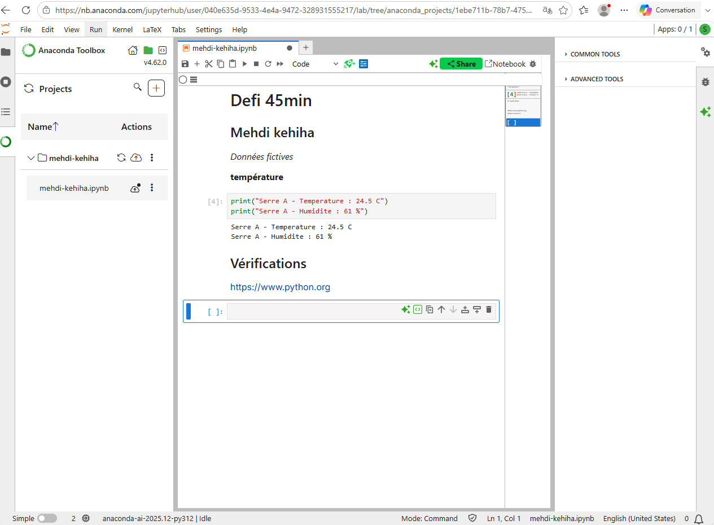

[README](evaluation/defi-45min/README.MD)

a) Il faut changer le type de la cellule de Markdown à Code dans Jupyter Notebook. Ensuite, exécuter la cellule avec Shift + Entrée. Pour vérifier, le résultat coucou doit apparaître sous la cellule.

b) GitHub utilise Git, qui ne conserve pas les dossiers vides. Il faut donc créer au moins un fichier dans le dossier (par exemple README.md) pour que Git puisse l'enregistrer et l'afficher sur GitHub.
